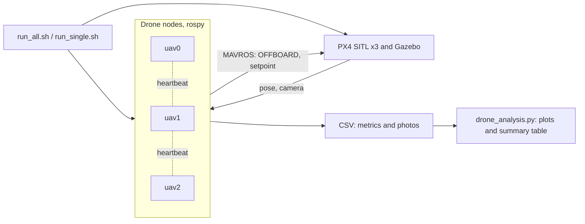
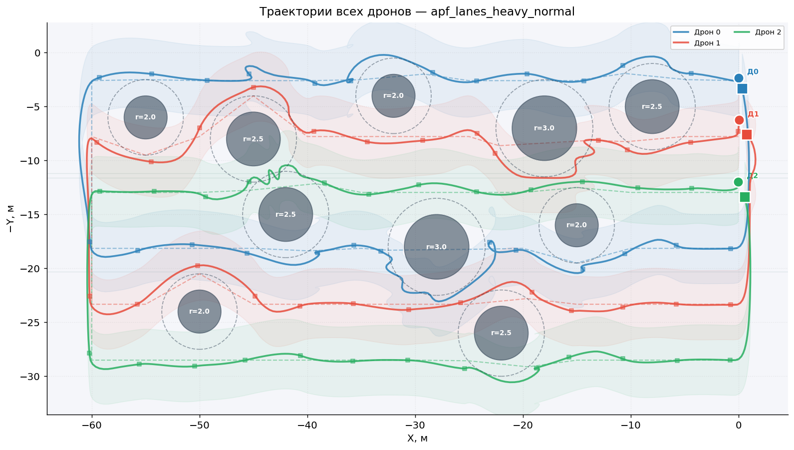
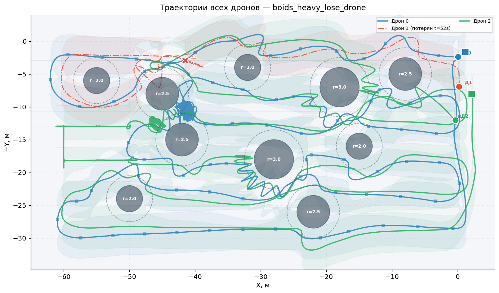
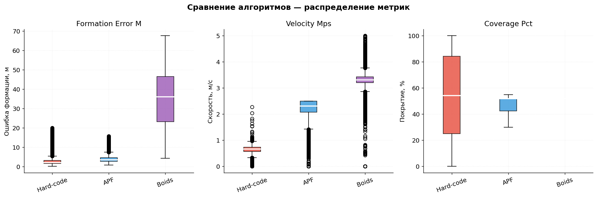
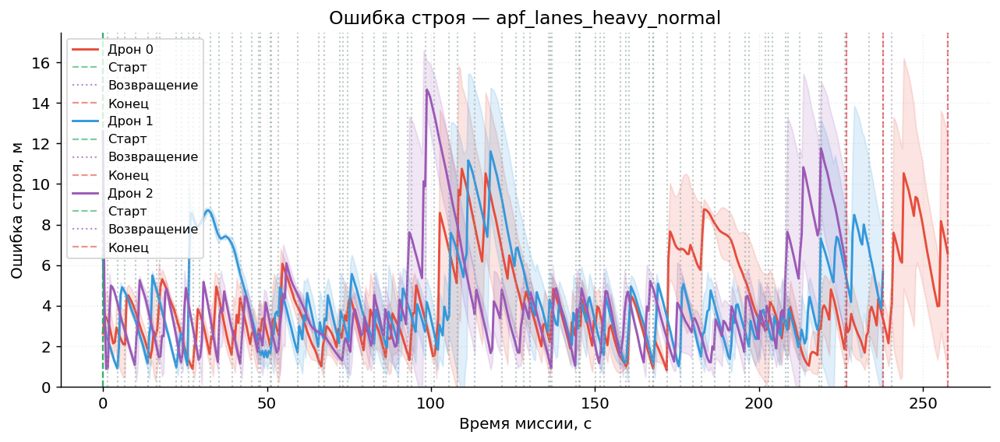

# Multi-Quadcopter Control: Keeping Formation (Bachelor Thesis)

[Русская версия](README.md)

Bachelor thesis (2026) on software and algorithms for controlling a group of quadcopters that keeps formation. Three drones in PX4 SITL and Gazebo sweep an area in a snake pattern, photograph it with overlapping frames, keep formation, avoid obstacles and continue the mission when one drone fails. Four algorithms are compared, and experiments run automatically in batches.

## Algorithms

| File | Algorithm |
|---|---|
| `hard_code_drones.py` | Hard-coded offsets: the leader flies the route, followers keep a fixed offset from it |
| `apf_drones.py` | Artificial potential fields: attraction to the route point, repulsion from obstacles and neighbors, a tangential term to go around obstacles, alignment and cohesion with the group |
| `apf_with_lanes_drones.py` | Potential fields with lanes: each drone has its own survey lane and returns to it after avoiding an obstacle |
| `boids_drones.py` | Boids (Reynolds rules): separation, alignment, cohesion |

## How it works



- **One node per drone** (`rospy`, MAVROS):
  - switches to OFFBOARD and arms, then controls velocity;
  - camera via `cv_bridge`, photos along the snake route with 20% overlap at a 78° field of view;
  - metrics are logged to CSV five times per second.
- **Synchronization and drone loss.** The drones exchange heartbeats and start on a shared barrier. A drone that stays silent for more than 3 s is treated as lost, and the group continues without it.
- **Experiment batches.** The run scripts (`run_*.sh`, `common.sh`, `launch_experiment.py`):
  - bring up `px4 multi_uav_mavros_sitl.launch` themselves;
  - restart PX4 and Gazebo every two runs and reset the scene (`reset_gazebo.py`);
  - in drone-loss mode, stop one drone 70 s after the mission starts.
- **Analysis** (`drone_analysis.py`, `plot_trajectories.py`):
  - trajectories;
  - formation error and lane deviation;
  - nearest-neighbor distance and coverage;
  - a summary table and an algorithm comparison.
- **Prototypes** (`prototypes/`): the first potential-field control versions, an APF mission with photo capture (`swarm_apf_mission.py`) and an early modular version of the package (`swarm_pkg/`: per-drone node, snake route planner, formation manager, logger).
- **Early analysis versions** (`analysis/`) and the plan of the experiment series (`docs/experiment_plan.md`, in Russian).

## Experiments

There are six scenarios: three environments (no obstacles, light, heavy) in two modes (normal and drone loss). The batch matrix covers 72 experiments: 4 algorithms × 6 scenarios × 3 runs. Hard-coded offsets run all drones in one process, so their drone-loss scenarios are skipped, which leaves 63 completed runs.

Averages over three environments and three drones from [`results/summary_table.csv`](results/summary_table.csv), normal mode:

| Algorithm | Formation error, m | Nearest neighbor, m | Speed, m/s | Coverage, % | Mission time, s |
|---|---|---|---|---|---|
| Hard-coded offsets | 3.15 | — | 0.62 | 52.6 | 224 |
| Potential fields | 4.19 | 7.54 | 2.23 | 51.6 | 198 |
| Potential fields with lanes | 4.18 | 6.54 | 2.18 | 51.7 | 209 |
| Boids | 35.84 | 2.67 | 3.27 | 51.8 | 154 |

With a drone lost, the formation error of the potential-field methods stays at about 4 m (4.05 and 4.01 m). Coverage drops to about 47% because the lost drone's lane remains unsurveyed. Boids is the fastest but does not keep formation.

<table>
  <tr>
    <td></td>
    <td></td>
  </tr>
  <tr>
    <td align="center">Potential fields with lanes, heavy environment</td>
    <td align="center">Boids, heavy environment, drone 1 lost</td>
  </tr>
  <tr>
    <td></td>
    <td></td>
  </tr>
  <tr>
    <td align="center">Distribution of formation error, speed and coverage by algorithm</td>
    <td align="center">Formation error over time, potential fields with lanes</td>
  </tr>
</table>

Plot labels are in Russian, as in the thesis. The raw data is in the [release](../../releases/tag/experiment-data): run metrics in CSV, photo telemetry and camera frames. `vkr_results.zip` holds the first batch with plots and the summary table, `vkr_results_maps.zip` holds the full batch with photos for mapping.

## Quick start

Requires Ubuntu 20.04, ROS Noetic, MAVROS, PX4-Autopilot (SITL) and Gazebo.

```bash
./run_single.sh apf heavy normal 1        # one run: algorithm, environment, mode, run number
./run_all.sh ~/vkr_results                # the whole batch
python3 drone_analysis.py --base ~/vkr_results --out ~/vkr_results/plots
```

Algorithms: `hardcode`, `apf`, `apf_lanes`, `boids`. Environments: `no_obstacles`, `light`, `heavy`. Modes: `normal`, `lose_drone`.

## Tech stack

Python, ROS (rospy), MAVROS, PX4 SITL, Gazebo, OpenCV (`cv_bridge`), pandas, NumPy, SciPy, Matplotlib, Bash.

## License

[MIT](LICENSE)
