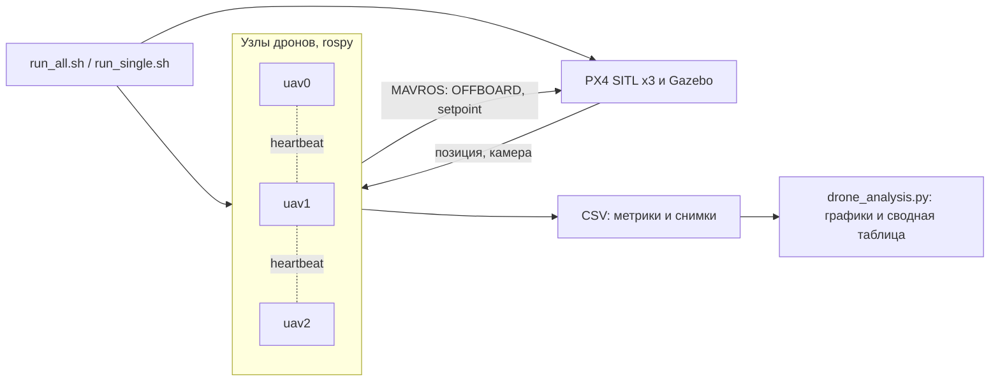
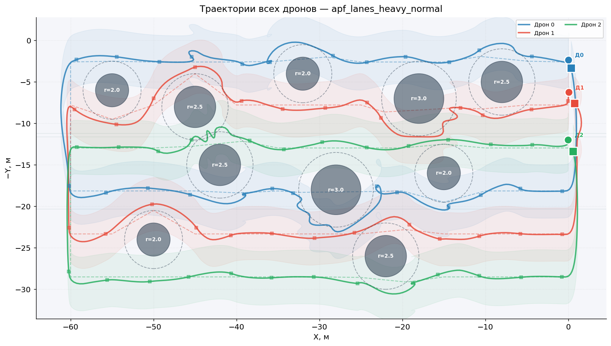
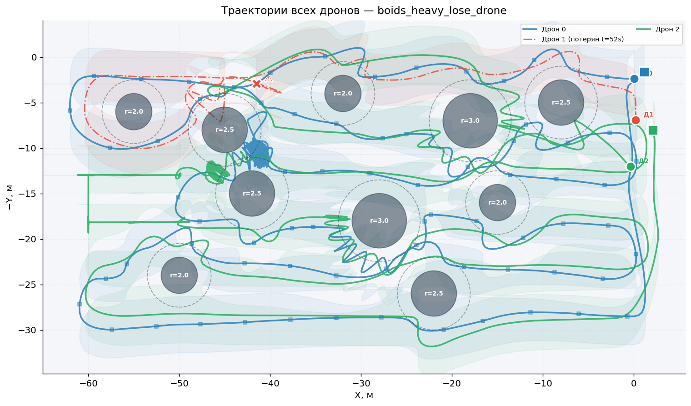
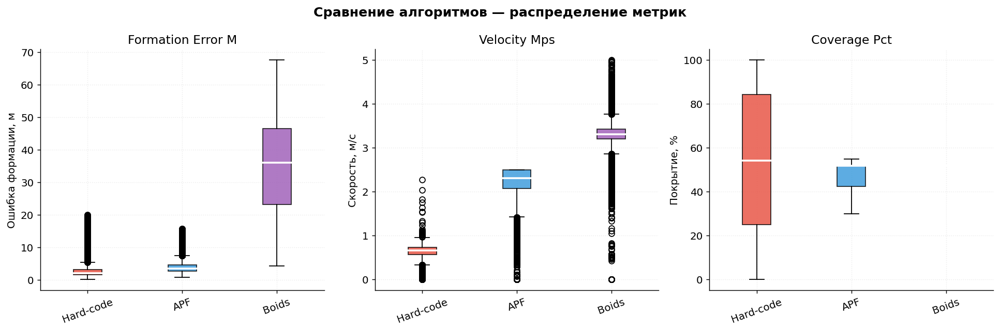
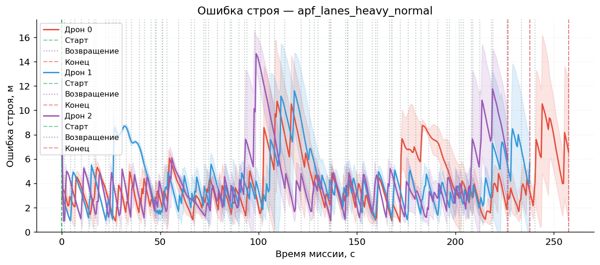

# Групповое управление квадрокоптерами: удержание строя (ВКР)

[English version](README.en.md)

Выпускная квалификационная работа бакалавра (2026), тема «Программно-алгоритмическое обеспечение системы управления группой квадрокоптеров для задач удержания строя». Три дрона в PX4 SITL и Gazebo облетают область змейкой, фотографируют её с перекрытием кадров, держат строй, обходят препятствия и продолжают миссию при отказе одного из дронов. Сравниваются четыре алгоритма, эксперименты запускаются автоматически сериями.

## Алгоритмы

| Файл | Алгоритм |
|---|---|
| `hard_code_drones.py` | Жёсткое смещение: ведущий проходит маршрут, ведомые держат фиксированное смещение относительно него |
| `apf_drones.py` | Метод потенциальных полей: притяжение к точке маршрута, отталкивание от препятствий и соседей, тангенциальная составляющая для обхода, выравнивание и сцепление с группой |
| `apf_with_lanes_drones.py` | Потенциальные поля с полосами: у каждого дрона своя полоса съёмки, после обхода препятствия он возвращается на неё |
| `boids_drones.py` | Boids (правила Рейнольдса): разделение, выравнивание, сцепление |

## Как устроено



- **Узел на каждый дрон** (`rospy`, MAVROS):
  - переход в OFFBOARD и арминг, затем управление скоростью;
  - камера через `cv_bridge`, снимки маршрута змейкой с перекрытием 20 % при угле обзора 78°;
  - метрики пишутся в CSV пять раз в секунду.
- **Синхронизация и отказ дрона.** Дроны обмениваются heartbeat. Старт идёт по общему барьеру. Если от дрона нет сигнала дольше 3 с, группа считает его потерянным и продолжает миссию без него.
- **Серия экспериментов.** Скрипты запуска (`run_*.sh`, `common.sh`, `launch_experiment.py`):
  - сами поднимают `px4 multi_uav_mavros_sitl.launch`;
  - перезапускают PX4 и Gazebo каждые два прогона и сбрасывают сцену (`reset_gazebo.py`);
  - в режиме отказа останавливают один дрон через 70 с после старта миссии.
- **Анализ** (`drone_analysis.py`, `plot_trajectories.py`):
  - траектории;
  - ошибка строя и отклонение от полосы;
  - расстояние до ближайшего соседа и покрытие;
  - сводная таблица и сравнение алгоритмов.
- **Прототипы** (`prototypes/`): первые версии управления на потенциальных полях, миссия APF с фотосъёмкой (`swarm_apf_mission.py`) и ранний модульный вариант пакета (`swarm_pkg/`: узел дрона, планировщик маршрута «змейкой», менеджер строя, логгер).
- **Ранние версии анализа** (`analysis/`) и план серии экспериментов (`docs/experiment_plan.md`).

## Эксперименты

Сценариев шесть: три среды (без препятствий, лёгкая, тяжёлая) в двух режимах (штатный и отказ дрона). Матрица серии рассчитана на 72 эксперимента: 4 алгоритма × 6 сценариев × 3 прогона. Жёсткое смещение держит всех дронов в одном процессе, поэтому сценарии с отказом для него пропускаются, и выполненных прогонов 63.

Средние по трём средам и трём дронам из [`results/summary_table.csv`](results/summary_table.csv), штатный режим:

| Алгоритм | Ошибка строя, м | До ближайшего соседа, м | Скорость, м/с | Покрытие, % | Время миссии, с |
|---|---|---|---|---|---|
| Жёсткое смещение | 3,15 | — | 0,62 | 52,6 | 224 |
| Потенциальные поля | 4,19 | 7,54 | 2,23 | 51,6 | 198 |
| Потенциальные поля с полосами | 4,18 | 6,54 | 2,18 | 51,7 | 209 |
| Boids | 35,84 | 2,67 | 3,27 | 51,8 | 154 |

При отказе дрона ошибка строя у потенциальных полей остаётся около 4 м (4,05 и 4,01 м). Покрытие падает примерно до 47 %, потому что полоса потерянного дрона остаётся неснятой. Boids летит быстрее всех, но строй не держит.

<table>
  <tr>
    <td></td>
    <td></td>
  </tr>
  <tr>
    <td align="center">Потенциальные поля с полосами, тяжёлая среда</td>
    <td align="center">Boids, тяжёлая среда, отказ дрона 1</td>
  </tr>
  <tr>
    <td></td>
    <td></td>
  </tr>
  <tr>
    <td align="center">Распределение ошибки строя, скорости и покрытия по алгоритмам</td>
    <td align="center">Ошибка строя во времени, потенциальные поля с полосами</td>
  </tr>
</table>

Сырые данные лежат в [релизе](../../releases/tag/experiment-data): метрики прогонов в CSV, телеметрия снимков и кадры с камер. В `vkr_results.zip` первая серия с графиками и сводной таблицей, в `vkr_results_maps.zip` полная серия со снимками для карт.

## Запуск

Нужны Ubuntu 20.04, ROS Noetic, MAVROS, PX4-Autopilot (SITL) и Gazebo.

```bash
./run_single.sh apf heavy normal 1        # один прогон: алгоритм, среда, режим, номер
./run_all.sh ~/vkr_results                # вся серия
python3 drone_analysis.py --base ~/vkr_results --out ~/vkr_results/plots
```

Алгоритмы: `hardcode`, `apf`, `apf_lanes`, `boids`. Среды: `no_obstacles`, `light`, `heavy`. Режимы: `normal`, `lose_drone`.

## Стек

Python, ROS (rospy), MAVROS, PX4 SITL, Gazebo, OpenCV (`cv_bridge`), pandas, NumPy, SciPy, Matplotlib, Bash.

## Лицензия

[MIT](LICENSE)

---

<sub>Код написан в апреле–мае 2026, на GitHub выложен в ноябре 2026. Даты коммитов взяты по датам исходных файлов, README и иллюстрации добавлены при выгрузке.</sub>
